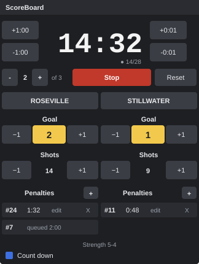

<div align="center">

# 🏒 ScoreBoard for OBS

**Live scoreboard for OBS Studio — the clock and every value are written straight into your Text sources, the instant they change.**
**Tabellone in diretta per OBS Studio — il cronometro e ogni valore vengono scritti direttamente nelle tue sorgenti Text, nell'istante in cui cambiano.**

[English](#english) · [Italiano](#italiano)

[](https://github.com/angeloruggieridj/obs-scoreboard/releases/latest)
[](https://github.com/angeloruggieridj/obs-scoreboard/releases)
[](LICENSE)


[](https://github.com/angeloruggieridj/obs-scoreboard/actions/workflows/push.yaml)
[](https://github.com/angeloruggieridj/obs-scoreboard/actions/workflows/core-tests.yaml)
[](https://github.com/angeloruggieridj/obs-scoreboard/actions/workflows/selftest.yaml)
[](https://github.com/angeloruggieridj/obs-scoreboard/actions/workflows/integrations.yaml)

<table>
  <tr>
    <td align="center"><br><sub>The dock in OBS (ice hockey, idle)</sub></td>
    <td align="center"><br><sub>Illustration: a match in progress</sub></td>
  </tr>
</table>

</div>

## English

### Why

OBS Text sources read a `.txt` file **once a second** and compare its **whole-second** timestamp. Two updates in the
same second → the second is never seen, and the stream clock visibly skips (`19:29 → 19:27`). Scoreboard plugins
that write files cannot fix this.

**ScoreBoard for OBS does not use files.** It writes the text **directly into your Text source** through the OBS API,
at the exact moment a value changes. You keep your own font, color and position; the plugin only changes the text.

### Features

| | |
|---|---|
| **Direct update** | 28 values (clock, period, names, scores, shots, fouls, penalties, strength, play time…), each linked to a Text source; updated only when the text changes. Links survive renaming, scene changes, restarts and scene collections. |
| **Precise clock** | Tenths of a second, up or down, monotonic time base; ±1 min / ±1 s arrows capped to the period; two-digit minutes; stoppage time. |
| **14 sports** | Ice hockey, basketball, soccer, futsal, American football, lacrosse, rugby union and sevens, field hockey, water polo, handball, rink hockey, floorball, generic — editable presets. |
| **Timed penalties** | Up to 8 per team, 2 running at once, compound (2+2…), edit/cancel per penalty, strength text (`5-4`). |
| **Compact dock** | Narrow, no scrolling, custom score/foul colors; match saved as you play and resumable after a restart. |
| **Hotkeys** | 40 OBS hotkeys, stored in the scene collection. |
| **Remote control** | obs-websocket vendor, native **Stream Deck** plugin, **Bitfocus Companion** module. |
| **Extras** | Optional `.txt` output; event log and **YouTube chapters** export; update notice. |

### Installation

Requires **OBS Studio 30.0+**. Download from the [releases page](https://github.com/angeloruggieridj/obs-scoreboard/releases):

| System | Package |
|---|---|
| Windows | `…-windows-x64-setup.exe` (installer) or the `.zip` (portable OBS: extract into its plugins folder) |
| macOS | `…-macos-universal.pkg` (unsigned: first launch → right-click → *Open*) |
| Linux (Ubuntu 24.04) | `.deb` or `.tar.xz` |

Close OBS, install, then enable **Docks → ScoreBoard**. The first launch asks which sport you score.
Releases ship SHA-256 checksums and a build provenance attestation
(`gh attestation verify <file> --repo angeloruggieridj/obs-scoreboard`). Verified OBS versions: [obs-compat.json](obs-compat.json).

### Quick start

1. Add a **Text** source for the clock — or let the plugin create it: dock menu **⋮ → Source links… → +**.
2. In *Source links…* pick it for **Clock** (and any other value you want on screen).
3. Press **Start**. OBS shows the new text on the very next frame.

### Remote control

| Client | What it is | Docs |
|---|---|---|
| obs-websocket | vendor `obs-scoreboard`: 20 requests, 4 events, resolved at run time (the plugin works without obs-websocket) | [docs/remote-control.md](docs/remote-control.md) |
| Stream Deck | native plugin, one action per command, live key feedback | [streamdeck/](streamdeck/) |
| Bitfocus Companion | native module: actions, feedbacks, variables, presets | [companion/](companion/) |

Enable the server in OBS: **Tools → WebSocket Server Settings**. Stream Deck stores the connection password in its
own global settings, in plain text.

### Output files and YouTube chapters

- **File output** (off by default): *Match settings → Output* — one `.txt` per value in a folder you pick, rewritten only
  when its content changed (atomic writes). For other tools; Text sources are updated directly regardless.
- **Event log…** (dock menu): every event with its time; **export YouTube chapters** (`0:00 Title`) relative to the stream
  start, the recording start or game time, to the clipboard or a `.txt`. Text only — nothing is written into a recording.

### Updates

Once per OBS start the plugin asks GitHub for the latest release (only its own version number is sent) and, if
newer, adds **Update available** to the dock menu. Nothing is downloaded or installed. Switch it off in the menu.

### Building from source

CMake, a C++17 compiler, Qt 6 and OBS Studio 30.0+ development files; [CMake presets](CMakePresets.json) included.

```bash
cmake -S tests -B build_tests && cmake --build build_tests --config Debug      # core tests: no OBS, no Qt
ctest --test-dir build_tests -C Debug --output-on-failure
cmake --preset windows-x64 && cmake --build --preset windows-x64               # plugin (macos / ubuntu-x86_64 too)
```

Details, translation checks and loading a build into OBS: [CONTRIBUTING.md](CONTRIBUTING.md).
History: [CHANGELOG.md](CHANGELOG.md). Problems or ideas: [issues](https://github.com/angeloruggieridj/obs-scoreboard/issues).

### License

GPL-2.0-or-later, like OBS Studio — see [LICENSE](LICENSE). The Companion module in [companion/](companion/) is MIT.
The clock font [DSEG7](third_party/dseg/DSEG-LICENSE.txt) is under the SIL Open Font License 1.1.

---

## Italiano

### Perché

Le sorgenti Text di OBS leggono un file `.txt` **una volta al secondo** e ne confrontano la data al **secondo intero**.
Due aggiornamenti nello stesso secondo → il secondo non viene visto e il cronometro in diretta salta (`19:29 → 19:27`).
I plugin che scrivono file non possono risolverlo.

**ScoreBoard for OBS non usa i file.** Scrive il testo **direttamente nella tua sorgente Text** tramite l'API di OBS, nel
momento esatto in cui il valore cambia. Font, colore e posizione restano i tuoi: il plugin cambia solo il testo.

### Funzionalità

| | |
|---|---|
| **Aggiornamento diretto** | 28 valori (cronometro, periodo, nomi, punteggi, tiri, falli, penalità, inferiorità, tempo di gioco…), ognuno collegato a una sorgente Text; aggiornata solo se il testo cambia. I collegamenti sopravvivono a rinomina, cambio scena, riavvio e collezioni di scene. |
| **Cronometro preciso** | Decimi di secondo, avanti o indietro, base temporale monotona; frecce ±1 min / ±1 s limitate al periodo; minuti a due cifre; recupero. |
| **14 sport** | Hockey su ghiaccio, basket, calcio, futsal, football americano, lacrosse, rugby a 15 e a 7, hockey su prato, pallanuoto, pallamano, hockey su pista, floorball, generico — preset modificabili. |
| **Penalità a tempo** | Fino a 8 per squadra, 2 in corso, composte (2+2…), modifica/annulla per penalità, testo di inferiorità (`5-4`). |
| **Pannello compatto** | Stretto, senza scorrimento, colori di punteggi/falli personalizzabili; partita salvata mentre si gioca e riprendibile dopo un riavvio. |
| **Hotkey** | 40 hotkey OBS, salvate nella collezione di scene. |
| **Controllo remoto** | vendor obs-websocket, plugin **Stream Deck** nativo, modulo **Bitfocus Companion**. |
| **Extra** | Output `.txt` opzionale; registro eventi ed esportazione **capitoli YouTube**; avviso di aggiornamento. |

### Installazione

Richiede **OBS Studio 30.0+**. Scarica dalla [pagina delle release](https://github.com/angeloruggieridj/obs-scoreboard/releases):

| Sistema | Pacchetto |
|---|---|
| Windows | `…-windows-x64-setup.exe` (installer) oppure lo `.zip` (OBS portatile: estrarre nella sua cartella plugin) |
| macOS | `…-macos-universal.pkg` (non firmato: primo avvio → tasto destro → *Apri*) |
| Linux (Ubuntu 24.04) | `.deb` oppure `.tar.xz` |

Chiudi OBS, installa, poi attiva **Pannelli → ScoreBoard**. Al primo avvio viene chiesto quale sport segui.
Le release includono checksum SHA-256 e attestazione di provenienza
(`gh attestation verify <file> --repo angeloruggieridj/obs-scoreboard`). Versioni di OBS verificate: [obs-compat.json](obs-compat.json).

### Primi passi

1. Aggiungi una sorgente **Text** per il cronometro — oppure falla creare al plugin: menu del pannello **⋮ → Collegamenti sorgenti… → +**.
2. In *Collegamenti sorgenti…* sceglila per **Cronometro** (e per ogni altro valore da mostrare).
3. Premi **Avvia**. OBS mostra il nuovo testo al fotogramma successivo.

### Controllo remoto

| Client | Cos'è | Documentazione |
|---|---|---|
| obs-websocket | vendor `obs-scoreboard`: 20 richieste, 4 eventi, risolto a runtime (il plugin funziona anche senza obs-websocket) | [docs/remote-control.md](docs/remote-control.md) |
| Stream Deck | plugin nativo, un'azione per comando, feedback sui tasti | [streamdeck/](streamdeck/) |
| Bitfocus Companion | modulo nativo: azioni, feedback, variabili, preset | [companion/](companion/) |

Attiva il server in OBS: **Strumenti → Impostazioni server WebSocket**. Lo Stream Deck conserva la password di connessione
nelle proprie impostazioni globali, in chiaro.

### Output su file e capitoli YouTube

- **Output su file** (spento di default): *Impostazioni partita → Output* — un `.txt` per valore nella cartella scelta, riscritto
  solo se il contenuto cambia (scrittura atomica). Per altri strumenti; le sorgenti Text restano aggiornate direttamente.
- **Registro eventi…** (menu del pannello): ogni evento con il suo orario; **esporta i capitoli YouTube** (`0:00 Titolo`) rispetto
  all'inizio della diretta, della registrazione o al tempo di gioco, negli appunti o in un `.txt`. Solo testo: nulla viene scritto nella registrazione.

### Aggiornamenti

Una volta a ogni avvio di OBS il plugin chiede a GitHub l'ultima release (invia solo il proprio numero di versione) e, se più
recente, aggiunge **Aggiornamento disponibile** al menu del pannello. Non scarica né installa nulla. Si disattiva dal menu.

### Compilare dai sorgenti

CMake, compilatore C++17, Qt 6 e file di sviluppo di OBS Studio 30.0+; [preset CMake](CMakePresets.json) inclusi.

```bash
cmake -S tests -B build_tests && cmake --build build_tests --config Debug      # test del core: senza OBS né Qt
ctest --test-dir build_tests -C Debug --output-on-failure
cmake --preset windows-x64 && cmake --build --preset windows-x64               # plugin (anche macos / ubuntu-x86_64)
```

Dettagli, controllo delle traduzioni e caricamento in OBS: [CONTRIBUTING.md](CONTRIBUTING.md).
Storico: [CHANGELOG.md](CHANGELOG.md). Problemi o idee: [issues](https://github.com/angeloruggieridj/obs-scoreboard/issues).

### Licenza

GPL-2.0-or-later, come OBS Studio — vedi [LICENSE](LICENSE). Il modulo Companion in [companion/](companion/) è MIT.
Il font del cronometro [DSEG7](third_party/dseg/DSEG-LICENSE.txt) è sotto SIL Open Font License 1.1.
