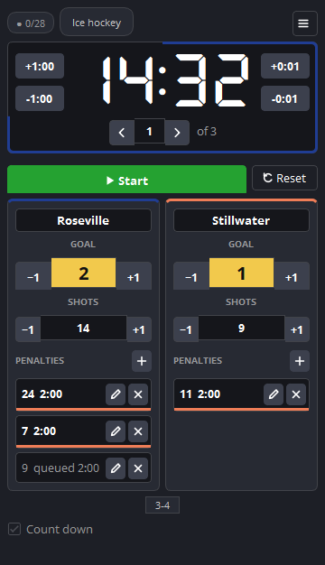
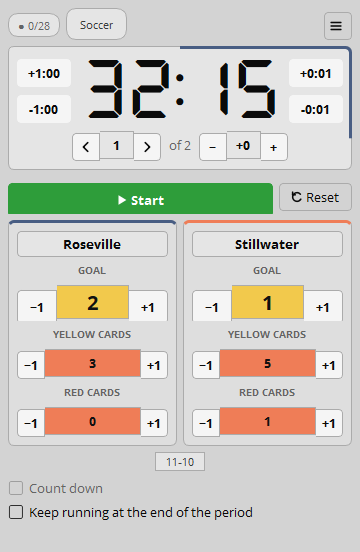
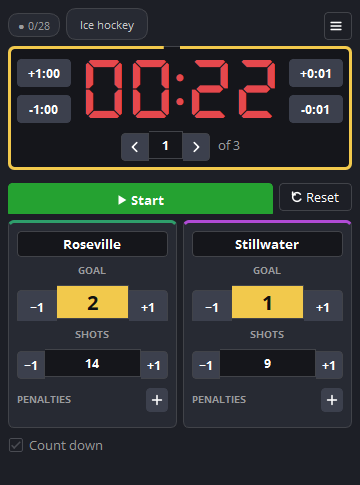

<div align="center">

# 🏒 ScoreBoard for OBS

**Scoreboard for OBS Studio that writes straight into your Text sources, the moment a value changes.**
**Tabellone per OBS Studio che scrive direttamente nelle tue sorgenti Text, nel momento in cui un valore cambia.**

[English](#english) · [Italiano](#italiano)

[](https://github.com/angeloruggieridj/obs-scoreboard/releases/latest)
[](https://github.com/angeloruggieridj/obs-scoreboard/releases)
[](LICENSE)


[](https://github.com/angeloruggieridj/obs-scoreboard/actions/workflows/push.yaml)
[](https://github.com/angeloruggieridj/obs-scoreboard/actions/workflows/core-tests.yaml)
[](https://github.com/angeloruggieridj/obs-scoreboard/actions/workflows/selftest.yaml)
[](https://github.com/angeloruggieridj/obs-scoreboard/actions/workflows/integrations.yaml)

<table>
  <tr>
    <td align="center"><br><sub>Ice hockey, OBS dark theme</sub></td>
    <td align="center"><br><sub>Soccer, OBS light theme</sub></td>
    <td align="center"><br><sub>Optional looks: team colors, progress border, clock color</sub></td>
  </tr>
</table>

</div>

## English

**Contents:** [Why](#why) · [Features](#features) · [Sports](#sports) · [Install](#install) · [Getting started](#getting-started) · [Remote control](#remote-control) · [Files and chapters](#files-and-youtube-chapters) · [Build](#build-from-source) · [License](#license)

### Why

OBS reads Text-source files once a second and compares timestamps with one-second precision, so two updates in the same
second lose one (the clock jumps `19:29 → 19:27`). ScoreBoard for OBS sets the source text through the OBS API instead,
so every change shows on the next frame. Your font, colors and position stay yours.

### Features

| | |
|---|---|
| **Direct updates** | 28 values (clock, period, names, scores, shots, fouls, penalties, strength, play time…), one Text source each; written only when the text changes. Links survive renames, scene changes, restarts and scene collections. |
| **Clock** | Tenths of a second, up or down; ±1 min / ±1 s arrows capped to the period; two-digit minutes; stoppage time. |
| **Sports** | 14 editable presets: ice hockey, basketball, soccer, futsal, American football, lacrosse, rugby union and sevens, field hockey, water polo, handball, rink hockey, floorball, generic. |
| **Penalties** | Up to 8 per team, 2 running; compound (2+2); edit or cancel each one; strength text (`5-4`). |
| **Dock** | Compact, no scrolling; custom score and foul colors; match autosaved and resumable. |
| **Hotkeys** | 40, stored in the scene collection. |
| **Remote control** | obs-websocket vendor, Stream Deck plugin, Bitfocus Companion module. |
| **Extras** | Optional `.txt` output, event log with YouTube chapters export, update notice. |

### Sports

14 presets, one per sport below. Every value is a default you can change in *Match settings*.

| Sport | Periods | Clock | Overtime | Extras and timed penalties |
|---|---|---|---|---|
| Ice hockey | 3 × 20:00 | down | 1 × 5:00 | Shots; penalties 2', 5', 10', 2+2, 2+5, 2+10; strength |
| Basketball | 4 × 10:00 | down | 5:00, as many as needed | Team fouls per quarter; points +1 / +2 / +3 |
| Soccer | 2 × 45:00 | up | 2 × 15:00 | Yellow and red cards; strength from red cards |
| Futsal | 2 × 20:00 | down | 2 × 5:00 | Accumulated fouls, reset for the 2nd half |
| American football | 4 × 15:00 | down | 1 × 10:00 | Flags; points +6 / +1 / +2 / +3 |
| Lacrosse | 4 × 15:00 | down | 4:00, as many as needed | Shots; penalties 30", 1', 2', 3'; strength |
| Rugby union | 2 × 40:00 | up | 2 × 10:00 | Points +5 / +2 / +3; penalties 10', 20'; strength |
| Rugby sevens | 2 × 7:00 | up | 5:00, as many as needed | Points +5 / +2 / +3; penalty 2'; strength |
| Field hockey | 4 × 15:00 | down | none | Penalties 2', 5', 10'; strength |
| Water polo | 4 × 8:00 | down | none | Shots; exclusion 20"; strength |
| Handball | 2 × 30:00 | up | 2 × 5:00 | Penalty 2'; strength |
| Rink hockey | 2 × 25:00 | down | 2 × 5:00 | Team fouls; penalties 2', 4'; strength |
| Floorball | 3 × 20:00 | down | 1 × 10:00 | Shots; penalties 2', 5', 10', 2+2, 2+10; strength |
| Generic | 1 open segment | up | none | A plain clock and score for any other sport |

### Install

Requires **OBS Studio 30.0+** (tested versions: [obs-compat.json](obs-compat.json)). Get the package from the
[releases page](https://github.com/angeloruggieridj/obs-scoreboard/releases):

| System | Package |
|---|---|
| Windows | `…-windows-x64-setup.exe`, or the `.zip` for portable OBS |
| macOS | `…-macos-universal.pkg` (unsigned: right-click → *Open* the first time) |
| Linux (Ubuntu 24.04) | `.deb` |

Close OBS, install, enable **Docks → ScoreBoard**; the first launch asks for your sport. Releases include SHA-256
checksums and a build attestation: `gh attestation verify <file> --repo angeloruggieridj/obs-scoreboard`.

### Getting started

1. Add a **Text** source for the clock, or create it from the dock menu: **⋮ → Settings → Source links… → +**.
2. In *Source links…*, pick it for **Clock** (repeat for any other value).
3. Press **Start**.

### Remote control

| Client | Notes |
|---|---|
| obs-websocket | Vendor `obs-scoreboard`: 20 requests, 4 events; optional at run time. [docs/remote-control.md](docs/remote-control.md) |
| Stream Deck | One action per command, live key feedback. [streamdeck/](streamdeck/) |
| Bitfocus Companion | Actions, feedbacks, variables, presets. [companion/](companion/) |

Enable the server under **Tools → WebSocket Server Settings**. The Stream Deck plugin stores the password in plain text.

### Files and YouTube chapters

| Feature | Where | Behavior |
|---|---|---|
| File output | *Match settings → Output* | Off by default. One `.txt` per value in a folder you choose, rewritten only when its content changes. |
| Event log | Dock menu → *Match → Event log…* | Lists events with times; exports YouTube chapters (`0:00 Title`) from stream start, recording start or game time, as text. |
| Update check | Dock menu → *Updates* | *Check for updates now* asks GitHub on demand; *Check for updates at start* does it once per start. Sends only the plugin version; notifies, never installs. |

### Look

| Feature | Where | Behavior |
|---|---|---|
| Sport | Dock header | The sport of the match is always shown next to the link indicator. |
| Team colors | *Match settings → Look* | Accent color of each team card; "Default" restores blue and orange. |
| Period progress | *Match settings → Look → Period progress* | The border of the clock frame shrinks with the time left (or fills with the time played). On by default; color and mode are yours, or turn it off. |
| Clock color | *Match settings → Look → Clock digits* | Off by default. One color, or up to four steps by time left (for example amber at 1:00, red at 0:30), optionally blended. |

### Build from source

CMake, C++17, Qt 6 and the OBS 30.0+ development files. See [CONTRIBUTING.md](CONTRIBUTING.md) for details.

```bash
cmake -S tests -B build_tests && cmake --build build_tests --config Debug    # core tests (no OBS, no Qt)
ctest --test-dir build_tests -C Debug --output-on-failure
cmake --preset windows-x64 && cmake --build --preset windows-x64             # plugin (also: macos, ubuntu-x86_64)
```

[CHANGELOG](CHANGELOG.md) · [Issues](https://github.com/angeloruggieridj/obs-scoreboard/issues) · [Security](SECURITY.md)

### License

GPL-2.0-or-later ([LICENSE](LICENSE)). Companion module: MIT. Clock font [DSEG7](third_party/dseg/DSEG-LICENSE.txt): SIL OFL 1.1.

---

## Italiano

**Indice:** [Perché](#perché) · [Funzionalità](#funzionalità) · [Sport](#sport) · [Installazione](#installazione) · [Primi passi](#primi-passi) · [Controllo remoto](#controllo-remoto) · [File e capitoli](#file-e-capitoli-youtube) · [Compilazione](#compilare-dai-sorgenti) · [Licenza](#licenza)

### Perché

OBS legge i file delle sorgenti Text una volta al secondo e confronta le date con precisione al secondo: due aggiornamenti
nello stesso secondo ne perdono uno (il cronometro salta da `19:29` a `19:27`). ScoreBoard for OBS imposta invece il testo
della sorgente tramite le API di OBS, così ogni cambio compare al fotogramma successivo. Font, colori e posizione restano i tuoi.

### Funzionalità

| | |
|---|---|
| **Aggiornamento diretto** | 28 valori (cronometro, periodo, nomi, punteggi, tiri, falli, penalità, inferiorità, tempo di gioco…), una sorgente Text ciascuno; scrittura solo se il testo cambia. I collegamenti reggono a rinomine, cambi scena, riavvii e collezioni di scene. |
| **Cronometro** | Decimi di secondo, avanti o indietro; frecce ±1 min / ±1 s limitate al periodo; minuti a due cifre; recupero. |
| **Sport** | 14 preset modificabili: hockey su ghiaccio, basket, calcio, futsal, football americano, lacrosse, rugby a 15 e a 7, hockey su prato, pallanuoto, pallamano, hockey su pista, floorball, generico. |
| **Penalità** | Fino a 8 per squadra, 2 in corso; composte (2+2); modifica o annulla ciascuna; testo di inferiorità (`5-4`). |
| **Pannello** | Compatto, senza scorrimento; colori di punteggi e falli personalizzabili; partita salvata in automatico e riprendibile. |
| **Hotkey** | 40, salvate nella collezione di scene. |
| **Controllo remoto** | Vendor obs-websocket, plugin Stream Deck, modulo Bitfocus Companion. |
| **Extra** | Output `.txt` facoltativo, registro eventi con esportazione dei capitoli YouTube, avviso di aggiornamento. |

### Sport

14 preset, uno per ogni sport qui sotto. Ogni valore è un'impostazione di partenza che puoi cambiare in *Impostazioni partita*.

| Sport | Periodi | Cronometro | Supplementari | Extra e penalità a tempo |
|---|---|---|---|---|
| Hockey su ghiaccio | 3 × 20:00 | indietro | 1 × 5:00 | Tiri; penalità 2', 5', 10', 2+2, 2+5, 2+10; inferiorità |
| Basket | 4 × 10:00 | indietro | 5:00, quanti servono | Falli di squadra per quarto; punti +1 / +2 / +3 |
| Calcio | 2 × 45:00 | avanti | 2 × 15:00 | Cartellini gialli e rossi; inferiorità dai rossi |
| Futsal | 2 × 20:00 | indietro | 2 × 5:00 | Falli accumulati, azzerati nel 2° tempo |
| Football americano | 4 × 15:00 | indietro | 1 × 10:00 | Flag; punti +6 / +1 / +2 / +3 |
| Lacrosse | 4 × 15:00 | indietro | 4:00, quanti servono | Tiri; penalità 30", 1', 2', 3'; inferiorità |
| Rugby a 15 | 2 × 40:00 | avanti | 2 × 10:00 | Punti +5 / +2 / +3; penalità 10', 20'; inferiorità |
| Rugby a 7 | 2 × 7:00 | avanti | 5:00, quanti servono | Punti +5 / +2 / +3; penalità 2'; inferiorità |
| Hockey su prato | 4 × 15:00 | indietro | nessuno | Penalità 2', 5', 10'; inferiorità |
| Pallanuoto | 4 × 8:00 | indietro | nessuno | Tiri; espulsione 20"; inferiorità |
| Pallamano | 2 × 30:00 | avanti | 2 × 5:00 | Penalità 2'; inferiorità |
| Hockey su pista | 2 × 25:00 | indietro | 2 × 5:00 | Falli di squadra; penalità 2', 4'; inferiorità |
| Floorball | 3 × 20:00 | indietro | 1 × 10:00 | Tiri; penalità 2', 5', 10', 2+2, 2+10; inferiorità |
| Generico | 1 segmento aperto | avanti | nessuno | Cronometro e punteggio semplici per qualsiasi altro sport |

### Installazione

Richiede **OBS Studio 30.0+** (versioni provate: [obs-compat.json](obs-compat.json)). Scarica il pacchetto dalla
[pagina delle release](https://github.com/angeloruggieridj/obs-scoreboard/releases):

| Sistema | Pacchetto |
|---|---|
| Windows | `…-windows-x64-setup.exe`, oppure lo `.zip` per OBS portatile |
| macOS | `…-macos-universal.pkg` (non firmato: la prima volta clic destro → *Apri*) |
| Linux (Ubuntu 24.04) | `.deb` |

Chiudi OBS, installa e attiva **Pannelli → ScoreBoard**; al primo avvio sceglierai lo sport. Le release includono i checksum
SHA-256 e un'attestazione della build: `gh attestation verify <file> --repo angeloruggieridj/obs-scoreboard`.

### Primi passi

1. Aggiungi una sorgente **Text** per il cronometro, oppure creala dal menu del pannello: **⋮ → Impostazioni → Collegamenti sorgenti… → +**.
2. In *Collegamenti sorgenti…* scegli quella sorgente per il **Cronometro** (e per gli altri valori che vuoi mostrare).
3. Premi **Avvia**.

### Controllo remoto

| Client | Note |
|---|---|
| obs-websocket | Vendor `obs-scoreboard`: 20 richieste, 4 eventi; facoltativo a runtime. [docs/remote-control.md](docs/remote-control.md) |
| Stream Deck | Un'azione per comando, feedback in tempo reale sui tasti. [streamdeck/](streamdeck/) |
| Bitfocus Companion | Azioni, feedback, variabili, preset. [companion/](companion/) |

Attiva il server da **Strumenti → Impostazioni server WebSocket**. Il plugin Stream Deck salva la password in chiaro.

### File e capitoli YouTube

| Funzione | Dove | Comportamento |
|---|---|---|
| Output su file | *Impostazioni partita → Output* | Spento di default. Un `.txt` per valore nella cartella scelta, riscritto solo se il contenuto cambia. |
| Registro eventi | Menu del pannello → *Partita → Registro eventi…* | Elenca gli eventi con l'orario; esporta i capitoli YouTube (`0:00 Titolo`) da inizio diretta, inizio registrazione o tempo di gioco, come testo. |
| Controllo aggiornamenti | Menu del pannello → *Aggiornamenti* | *Controlla aggiornamenti ora* interroga GitHub su richiesta; *Controlla gli aggiornamenti all'avvio* lo fa una volta per avvio. Invia solo la versione del plugin; avvisa, non installa. |

### Aspetto

| Funzione | Dove | Comportamento |
|---|---|---|
| Sport | Intestazione del pannello | Lo sport della partita è sempre visibile accanto all'indicatore dei collegamenti. |
| Colori squadra | *Impostazioni partita → Aspetto* | Colore d'accento della scheda di ogni squadra; "Predefinito" ripristina blu e arancione. |
| Avanzamento del periodo | *Impostazioni partita → Aspetto → Avanzamento del periodo* | Il bordo del riquadro del cronometro si accorcia col tempo rimanente (o si riempie col tempo giocato). Attivo di default; colore e modalità a scelta, oppure spento. |
| Colore del cronometro | *Impostazioni partita → Aspetto → Cifre del cronometro* | Spento di default. Un solo colore, oppure fino a quattro passaggi in base al tempo rimanente (ad esempio ambra a 1:00, rosso a 0:30), anche sfumati. |

### Compilare dai sorgenti

CMake, C++17, Qt 6 e i file di sviluppo di OBS 30.0+. Dettagli in [CONTRIBUTING.md](CONTRIBUTING.md).

```bash
cmake -S tests -B build_tests && cmake --build build_tests --config Debug    # test del core (senza OBS né Qt)
ctest --test-dir build_tests -C Debug --output-on-failure
cmake --preset windows-x64 && cmake --build --preset windows-x64             # plugin (anche: macos, ubuntu-x86_64)
```

[CHANGELOG](CHANGELOG.md) · [Issue](https://github.com/angeloruggieridj/obs-scoreboard/issues) · [Sicurezza](SECURITY.md)

### Licenza

GPL-2.0-or-later ([LICENSE](LICENSE)). Modulo Companion: MIT. Font del cronometro [DSEG7](third_party/dseg/DSEG-LICENSE.txt): SIL OFL 1.1.
